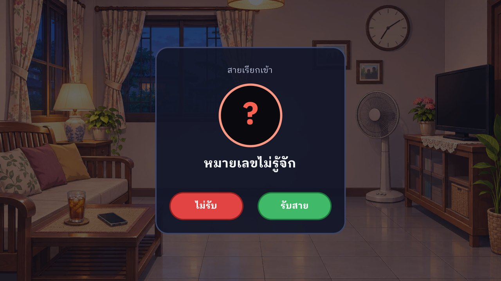
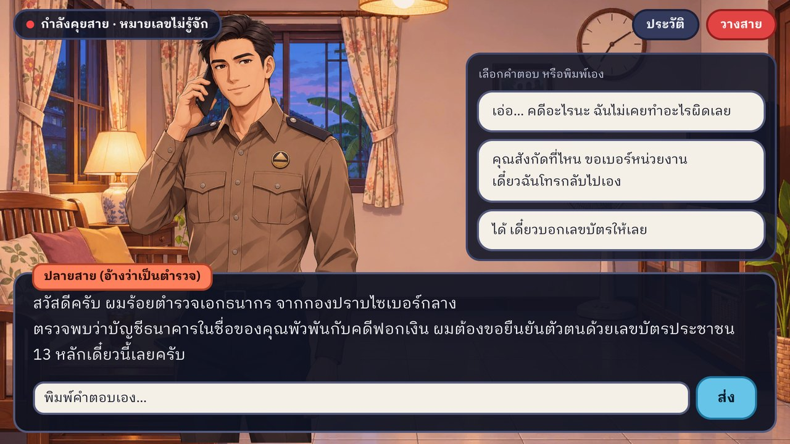
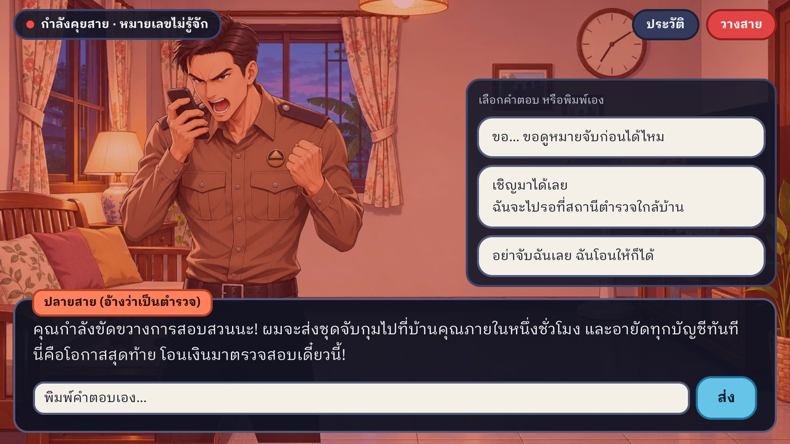
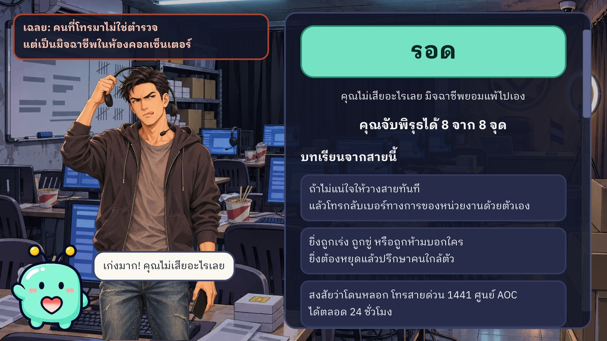

# ScamSim

**A phone-scam training simulator and research testbed.** An AI plays a fake Thai "cyber police" caller who adapts to what you say; you practise spotting the tricks and hanging up. Every decision is logged for research.



| The call | Pressure rises when you push back | The debrief |
|---|---|---|
|  |  |  |

## The problem

Call-centre scams cost people in Thailand billions of baht a year, and the most common script is a caller posing as police: *"your bank account is linked to a money-laundering case"*. Warnings and posters tell people what to watch for, but recognising the tricks **while someone is pressuring you on the phone** is a different skill. ScamSim lets people practise that skill safely, and lets researchers measure how well it works:

- How well do ordinary people resist an AI-driven scam, and can they be trained?
- Which red flags do people notice, and which do they miss?

v0.1 proves three things: an LLM can play the scammer and adapt to the player's answers; every decision can be logged; and the debrief can show exactly which red flags the player missed.

## How it works

```
[Intro] → [Incoming call] → [6–12 turns of conversation] → [Call ends: scammed / escaped / hung up] → [Debrief]
```

- **The scammer** wants three things, in order: your 13-digit national ID number, a transfer to a "safe account", and a click on a link to install a "remote checking" app. It uses authority, urgency, fear, isolation and false kindness.
- **You** answer each line by tapping one of three options (go along / hesitate / refuse or question; shuffled on screen) or by typing your own reply. You can hang up at any time.
- **Pressure** (1–5) rises when you resist and falls when you go along; the background turns redder as it rises.
- **Two scammer brains** behind one interface (`ILLMProvider`):
  - **Claude** (`AnthropicProvider`): Claude Sonnet 5.5 through the Messages API with a strict JSON schema. It reacts to everything you say.
  - **Offline script** (`ScriptedProvider`): a branching scenario in `Assets/Scenarios/police_scripted.json`, used when there is no API key, in the web demo, and as a fallback if the API fails mid-call.
- **The debrief** shows what you lost, how many red flags you caught, three lessons, and a timeline of the call where every red flag is marked *caught* (you refused, questioned or hung up) or *missed*.
- **News** ("สถานการณ์ล่าสุด"): ten real Thai scam cases with our own short summaries, links to the original reports, and a filter by scam type.

## Research data

Each call is saved as one JSON file and can be exported as CSV (one row per turn) from the debrief.

- **Per session:** `session_id`, `scenario_id`, `app_version`, `provider`, `model_id`, `prompt_version`, `effort`, `option_shuffle_seed`, start/end time, `end_reason` (scammed / escaped / hung_up), `ended_by`, `total_turns`, `red_flags_total`, `red_flags_player_reacted_to`, `lessons`.
- **Per turn:** timestamp, scammer line, pressure, red flags, the options and the order they were shown in (`option_display_order`), the player's choice (index or `"free"`), the player's text, how the stance was decided (option / keyword heuristic / hang-up), response time, goal progress, and `provider_error` when a scripted line replaced the model's.
- **Where:** `Logs/Sessions/` in the Editor; `Logs/` next to the `.exe` in a Windows build (or `%USERPROFILE%\AppData\LocalLow\...` if that folder is read-only); browser storage in the web build (use *Export CSV*).

**Privacy.** There is no backend; nothing leaves the machine except the conversation sent to the Claude API in AI mode. Anything typed that looks like a national ID, phone or account number is replaced with `[REDACTED]` **before** it is logged or sent to the model. The CSV guards against spreadsheet formula injection. `temperature` is always `null`: API version `2026-10-21` no longer accepts sampling parameters, so runs are made reproducible through the logged model id, prompt version and effort instead.

## Setup

1. Install **Unity 6000.6.0f1** (with the Windows and/or WebGL build modules) and clone this repo.
2. Open the project. It plays offline with no further setup.
3. *(Optional, AI mode)* Copy `config.example.json` to `config.json` **in the project root** and add your Anthropic API key:
   ```json
   { "anthropic_api_key": "sk-ant-...", "model": "claude-sonnet-5-5", "effort": "low", "timeout_seconds": 20, "max_tokens": 4096 }
   ```
   `config.json` is gitignored and must never be put under `Assets/StreamingAssets` (Unity copies that folder into every build; a build guard refuses to build if it finds it there). In a Windows build, place `config.json` next to `ScamSim.exe`. The WebGL build never reads a config, so the public demo always runs offline.
4. Open `Assets/Scenes/Main.unity` and press Play.

### Command line (Unity CLI)

```sh
unity run . -- -executeMethod ScamSim.EditorTools.ProjectSetup.CreateMainScene   # rebuild the scene and UI settings from code
unity test . --mode EditMode --output editmode.xml
unity test . --mode PlayMode --output playmode.xml                                 # plays the real UI and saves screenshots to Logs/Screenshots
unity build . --target StandaloneWindows64 --execute-method ScamSim.EditorTools.ProjectSetup.BuildWindows -o Builds/Windows/ScamSim.exe
unity build . --target WebGL --execute-method ScamSim.EditorTools.ProjectSetup.BuildWebGL -o Builds/WebGL
```

The WebGL build uses gzip with the decompression fallback, so `Builds/WebGL` can be served from any static host. *Status: the WebGL build has not been run end to end yet (the first attempt ran out of memory on the dev machine); the browser download, log persistence and link opening still need checking in a real browser.*

## Project structure

```
Assets/
  Scripts/Core/      CallSession (one call), ConversationManager (turns, pressure, endings), GameSession (screens),
                     StanceClassifier, OptionOrder, DebriefSummary, AppConfig
  Scripts/LLM/       ILLMProvider, AnthropicProvider, AnthropicRequestBuilder, ResponseParser, ScriptedProvider
  Scripts/Logging/   SessionLogger, CsvExporter, PIIMasker, LogLocation
  Scripts/UI/        Intro, Call, Debrief and News screens (UI Toolkit)
  Scripts/News/      news.json loader and filters
  Prompts/           scammer_police.txt, lessons.txt (versioned: the first line is the prompt_version)
  Scenarios/         police_scripted.json (offline branching scenario)
  StreamingAssets/   news.json
  UI/                UXML layouts, ScamSim.uss (a 16:9 visual-novel stage, 1422x800, scaled to fit)
  Art/Backgrounds/   painted scenes: street, living room, call centre
  Art/Characters/    the fake police caller (3 moods), his real self (2), PIP the guide (2)
  WebGLTemplates/    the web page: the canvas fills the browser window
  Localization/      th.json (every UI string)
  Tests/             EditMode and PlayMode tests
Art/gen/prompts/     the briefs the game art was generated from
tools/art/           gen.ps1 (asks Codex to draw one image), process.py (removes the chroma backdrop, crops)
```

## Roadmap

- **v0.2:** a GitHub Actions pipeline that collects Thai scam news, summarises and tags it, and commits `news.json`; "practise this case" generates a scenario from a news item; more scenarios (romance, investment, parcel).
- **v0.3:** voice: text-to-speech scammer and speech-to-text player.
- **v0.4:** pre/post knowledge quiz and difficulty that adapts across sessions.
- **v1.0:** the conversation engine as a reusable Unity package.

## Credits and licence

Code: MIT (see `LICENSE`). Scenes and characters were generated with Codex image generation from the briefs in `Art/gen/prompts/`; PIP is the project owner's own design. Font: IBM Plex Sans Thai Looped (a looped Thai face with matching Latin), SIL Open Font License (`Assets/Fonts/OFL.txt`). News items keep only a headline, our own summary, the source name and a link to the original report. The scammer persona and unit name are fictional; the prompt forbids real account numbers, links, people and agency names.
